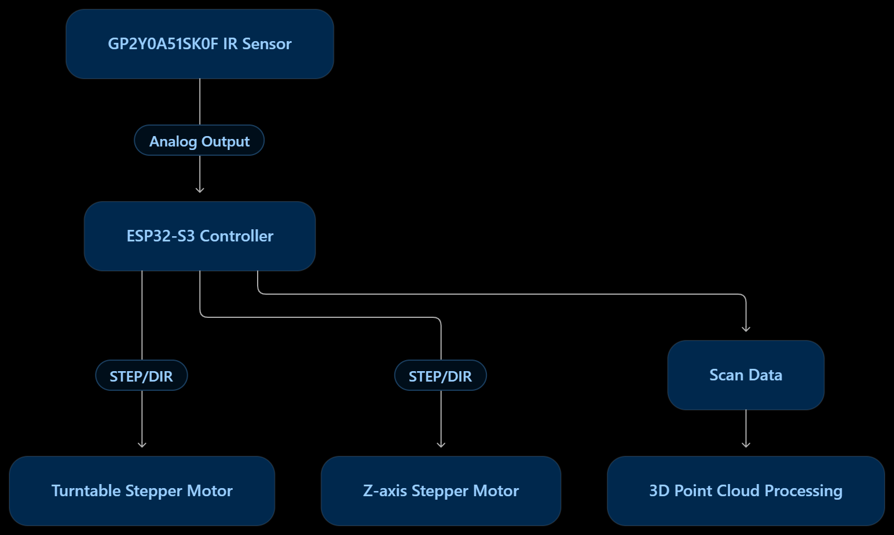
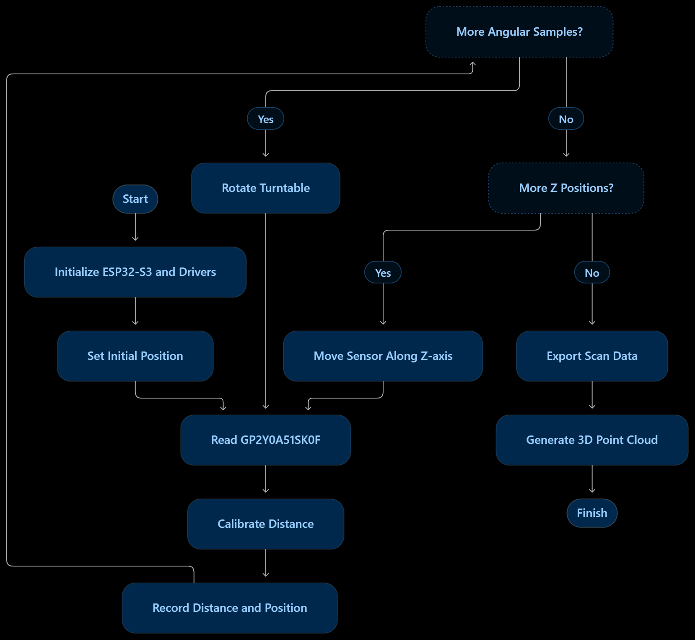

# System Specification

## 1. System Overview

The system uses an ESP32-S3 to control the scanning process. The GP2Y0A51SK0F infrared distance sensor measures the distance to the object's surface. Stepper motors control the turntable rotation and the sensor's vertical movement.

The collected distance and position data are used to reconstruct the object's 3D shape.

## 2. System Architecture

The ESP32-S3 reads the sensor's analog output and controls both stepper motors. Distance measurements are associated with the scanning positions to create 3D data.

## 3. System Operating Flowchart

The system initializes the sensor and motor drivers, then collects distance measurements at different angular and vertical positions. The scan ends when all configured positions have been measured.

## 4. Main Components

- **Controller:** ESP32-S3.
- **Distance Sensor:** GP2Y0A51SK0F infrared analog sensor.
- **Motion System:** Stepper motors for turntable rotation and Z-axis movement.
- **Output Data:** Distance measurements and corresponding scan positions.

