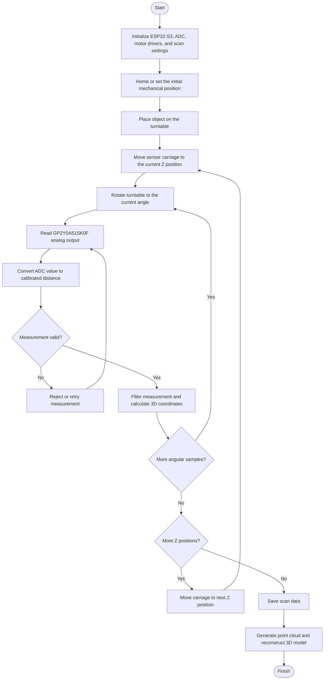

# 3D Scanner

## Project Overview

This project focuses on the design and development of a low-cost, homemade 3D scanner using embedded hardware, an infrared distance sensor, stepper-motor control, and a custom mechanical structure.

The system rotates an object on a turntable and moves the sensor assembly along the **Z-axis** to collect distance measurements from multiple positions. These measurements can be processed into a point cloud and used to reconstruct a three-dimensional model.

The current prototype uses the **Sharp GP2Y0A51SK0F infrared distance sensor**. The GP2Y0A51SK0F provides an analog voltage related to the distance of a nearby object. Its output is nonlinear.

The project is developed around our own hardware, firmware, mechanical design, and data-processing workflow. The goal is to create a functional prototype while studying how sensor characteristics, mechanical precision, sampling strategy, and reconstruction algorithms affect the quality of a 3D model.

## Why We Chose This Project

3D scanning has practical applications in manufacturing, reverse engineering, product design, digital modeling, and object measurement. Commercial scanners can be expensive or require specialized equipment, so this project explores a more affordable approach using commonly available components and embedded technology.

The project also provides practical experience in integrating sensors, motor control, mechanical design, firmware, calibration, and data processing. It is not only about collecting distance readings; reliable reconstruction also depends on repeatable motion, correct coordinate transformations, and robust handling of measurement noise.

## System Architecture

The prototype consists of the following main subsystems:

- **Distance sensing:** GP2Y0A51SK0F infrared analog distance sensor.
- **Motion control:** Stepper motors and driver modules control turntable rotation and vertical sensor movement.
- **Embedded controller:** ESP32-S3 coordinates motion, reads the sensor through an ADC (Analog-to-Digital Converter), and records measurements.
- **Mechanical structure:** A rotating platform, vertical guide rods, lead screw, and sensor carriage position the object and sensor.
- **Data processing:** Calibration, filtering, coordinate conversion, point-cloud generation, and 3D model reconstruction are intended as software-processing stages.

### System Flowchart

> **Note:** This flowchart describes the intended scanning workflow. Homing, automated data storage, point-cloud generation, and reconstruction should be marked as implemented only after they have been tested in the actual prototype.

## Hardware Requirements

| Component | Purpose |
| --- | --- |
| ESP32-S3 development board | Main controller for sensor acquisition and motion control |
| Sharp GP2Y0A51SK0F infrared distance sensor | Measures short-range distance using an analog voltage output |
| Stepper motors | Rotate the turntable and move the sensor carriage along the Z-axis |
| Stepper-motor driver modules | Drive the stepper motors from controller signals |

### Sensor Considerations

- The GP2Y0A51SK0F is a **short-range sensor** (nominally about 2–15 cm); it is not a direct drop-in replacement for a long-range LiDAR sensor.
- Its analog output is nonlinear. Use a measured calibration curve or lookup table rather than assuming distance is proportional to voltage.
- Select the ADC input and voltage range carefully. Do not exceed the ESP32-S3 GPIO/ADC electrical limits.
- Take multiple readings at each scan position and apply suitable filtering to reduce noise.
- Keep the sensor-to-object distance within the sensor's usable range. Surface color, reflectivity, angle, and ambient conditions can affect readings.
- Before scanning a complete object, validate the sensor against known distances and record the calibration data.

## Software and Development Tools

- **Arduino IDE or PlatformIO:** Firmware development and compilation for the ESP32-S3.
- **Git and GitHub:** Source-code version control and project collaboration.
- **Python (optional):** Process exported scan data, filter measurements, and generate point clouds.
- **MeshLab:** Inspect, clean, and edit reconstructed meshes.
- **Shapr3D (optional):** Design or revise mechanical parts for 3D printing.

## Scanning Workflow

1. **Prepare the scanner:** Check the frame, turntable, guide rods, lead screw, wiring, and motor drivers.
3. **Set scan parameters:** Define the vertical step size, angular step size, number of readings per position, and sensor working range.
4. **Acquire measurements:** Move the carriage along the Z-axis, rotate the object, and record valid distance readings at each position.
5. **Convert coordinates:** Combine the calibrated distance with the turntable angle and Z position to calculate 3D points. The exact coordinate transform depends on the sensor mounting geometry.
6. **Process the data:** Remove invalid points, filter noise, and export a point cloud.
7. **Reconstruct the model:** Use point-cloud or mesh-processing software to inspect and improve the resulting 3D representation.

## Current Limitations

- The GP2Y0A51SK0F is intended for short-range measurements and may not be suitable for every object size or scanner geometry.
- Infrared distance measurements can be affected by surface reflectivity, color, incidence angle, and ambient light.
- Mechanical backlash, vibration, turntable wobble, and inaccurate step sizes can introduce geometric errors.
- A single sensor moving along the Z-axis primarily captures the surfaces visible from its mounting direction. It cannot reliably capture every hidden surface, undercut, or interior wall.
- A usable 3D model depends on calibration and data-processing software in addition to the hardware.

## Future Development

### 1. AI-Assisted Surface Smoothing and Model Refinement

Develop an AI-assisted model-processing pipeline to reduce visible surface roughness and improve the visual quality of reconstructed models. It could identify noisy regions, suppress isolated outliers, and help produce smoother surfaces while preserving important edges and geometric details.

The goal should be to improve **perceived smoothness without inventing geometry**. Any AI-refined model should be compared with the original scan so that small features and dimensional accuracy are not accidentally lost.

### 2. Symmetry-Aware AI Reconstruction and Repair

Explore an AI-assisted reconstruction tool that uses an object's **center of symmetry, plane of symmetry, or axis of symmetry** to repair incomplete scans. For example, if one side of an object is missing or noisy, the software could estimate the corresponding geometry from the more complete side and reflect it across a known or estimated symmetry plane.

This feature would be most suitable for objects that are approximately symmetric. The system should let users inspect or adjust the estimated symmetry reference and distinguish measured geometry from AI-generated geometry.

## 3. Future Improvements

Develop a second scanning viewpoint using a camera or sensor mounted above the object, in addition to the current Z-axis scanning assembly. A top-mounted camera could capture complementary visual or geometric information and help address surfaces that the current sensor arrangement cannot observe.

For objects such as a drinking glass, the current single-axis setup may fail to capture the inner wall and depth of the cavity. A top-mounted camera could help detect the rim and observe the interior, but **a conventional camera alone does not directly provide reliable depth**. Recovering the inner wall may require calibrated multi-view imaging, stereo vision, structured light, or an additional depth-sensing method, with suitable lighting and calibration.

The longer-term goal is to combine multiple viewpoints into a more complete model while minimizing occluded regions.

## Project Goal

The immediate goal is to build a reliable low-cost prototype that can collect repeatable short-range measurements and turn them into a useful 3D representation. Future work will focus on improving calibration, expanding surface coverage, automating reconstruction, and exploring AI-assisted model refinement and symmetry-based repair.
