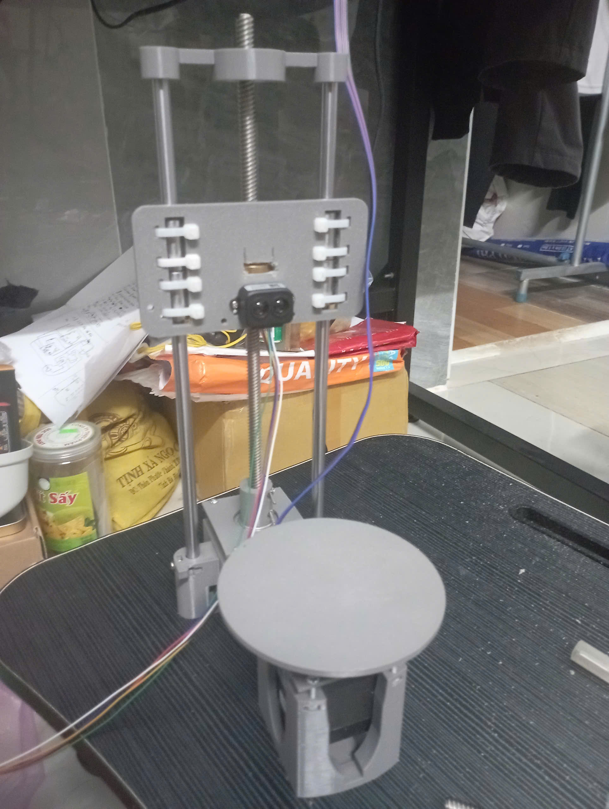

# Weekly Progress Report

## 1. Work Completed

- Integrated the mechanical frame developed in Week 1 with the electrical hardware developed in Week 2 to form a unified prototype.
- Arranged and assembled the electrical components within the frame to create a more compact and organized system.
- Consolidated the individual component test programs into a unified codebase for integrated system operation.
- Established communication with the ESP32-S3 and verified packet transmission and reception using sample data packets.
- Conducted initial tests to evaluate the interaction between the mechanical structure, electrical hardware, and control software.

## 2. Issues Encountered

- A minor short-circuit incident occurred on `Prototype_PCB_1` during system operation.
- The issue required inspection of the PCB wiring and soldering connections.
- Some faulty wire connections were identified and are currently being repaired.

## 3. Current Work and Next Steps

- Re-soldering faulty wire connections on `Prototype_PCB_1`.
- Inspecting the repaired circuit before resuming operation.
- Retesting ESP32-S3 communication and integrated system functions.
- Continuing system-level testing after the hardware repairs are completed.

## 4. Overall Progress

The mechanical frame and electrical hardware developed during the first two weeks have now been assembled into a unified prototype. The individual component test programs have also been consolidated, and basic ESP32-S3 data communication has been verified. Current efforts focus on repairing the PCB wiring issue and improving the reliability of the integrated system.

