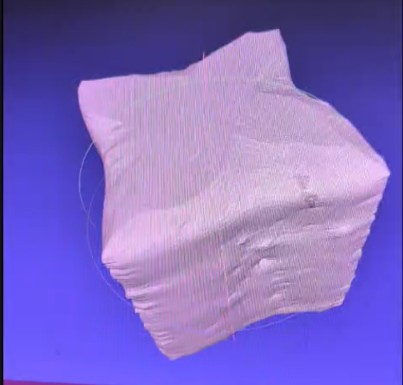

# Weekly Progress Report — Week 5

## 1. Work Completed

- Resolved the shortcomings identified in previous weeks, so the prototype can now complete a full scan.
- Successfully scanned a 3D object (a 4x4x4 Rubik's cube) and transmitted the scan data to the computer over the connection.
- Evaluated the scan result: the total height of the cube along the Oz axis is accurate.

## 2. Issues Encountered

- In the top view (Oxy plane), the square cross-section of the cube is reconstructed as a shape resembling a Japanese shuriken instead of a square, so the shape is severely distorted.
- The TF-Luna is accurate from 20 cm to 8 m, but in this setup the object is only about 3–10 cm from the sensor, which is below its minimum range. This causes large measurement errors and the distortion seen after scanning.
- The height along Oz is not affected, because it is determined by the Z-axis position and not by the distance reading.

## 3. Current Work and Next Steps

- The team decided to replace the TF-Luna with the Sharp GP2Y0A51SK0F infrared distance sensor, whose 2–15 cm range matches the actual operating distance and should give a smaller error.
- Connect the sensor's analog output to an ADC input of the ESP32-S3 and update the firmware.
- Calibrate the sensor at near range using reference distances, then rescan the Rubik's cube and compare the reconstructed dimensions with the real cube.

## 4. Overall Progress

The prototype can now scan an object and send the data to the computer, and the height is accurate. The remaining problem is the distortion in the Oxy plane caused by the TF-Luna's minimum range, which will be addressed by switching to the Sharp GP2Y0A51SK0F sensor.