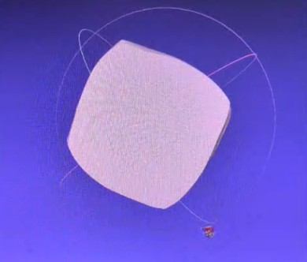

# Weekly Progress Report — Week 6

## 1. Work Completed

- Completed the 3D scanning product, including the hardware, the firmware, and the data transfer to the computer.
- Adjusted the processing and added surface-smoothing algorithms to reduce the surface roughness caused by deviations in the sensor measurements.
- Tested the final system by scanning the 4x4x4 Rubik's cube, whose real edge length is 60 mm.
- Completed the final project report.

## 2. Results

- The measured edge lengths of the cube range from 58.62 mm to 63.43 mm.
- Relative to the real 60 mm edge, the deviation ranges from about −2.3% to +5.7%, so the measurement error does not exceed 10%.
- The reconstructed shape is much closer to the real cube after the smoothing step.

## 3. Remaining Limitations

- The product still has some measurement deviation, which has been reduced but not eliminated.
- The remaining error comes from the accuracy of the sensor and the calibration at near range.

## 4. Overall Progress

The team has completed the product and the final report. The scanner reconstructs the Rubik's cube with a measurement error below 10%, which is acceptable for the project's goal. The remaining deviation can be reduced in future work with more precise calibration or a more accurate sensor.